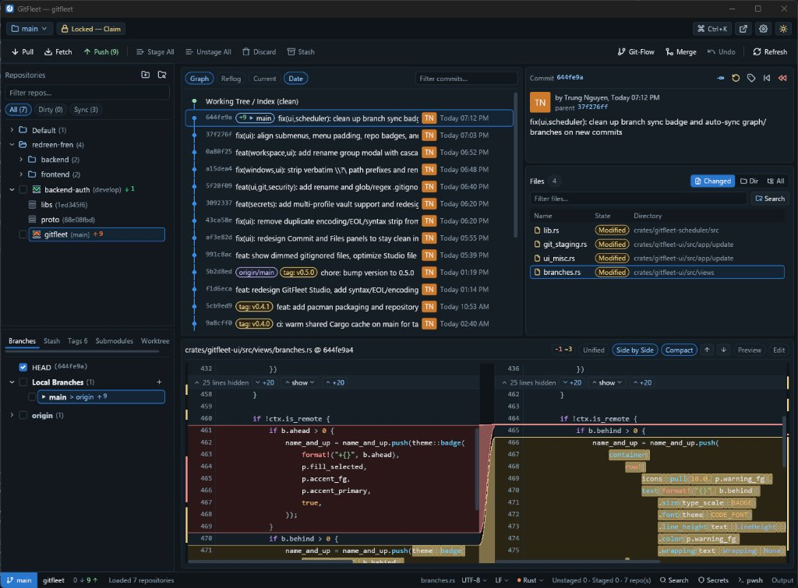
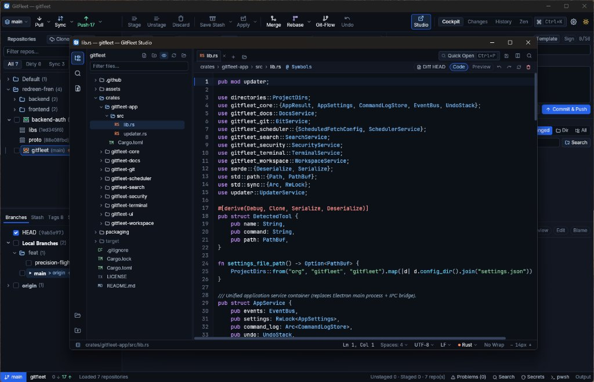
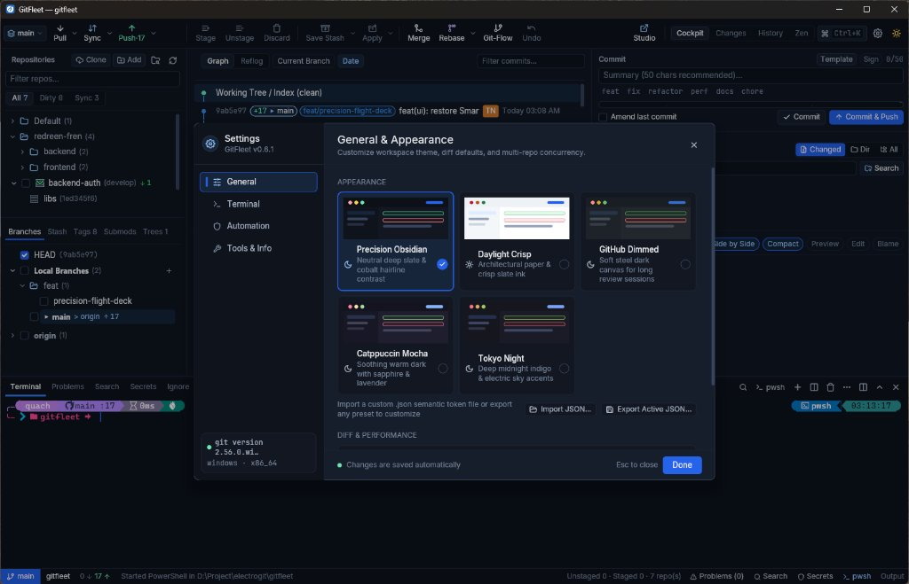

<p align="center">
  
</p>

<h1 align="center">GitFleet</h1>

<p align="center">
  <strong>Open-source, 100% pure-Rust multi-repository Git desktop workspace manager &amp; code workbench.</strong>
</p>

<p align="center">
  <a href="https://github.com/ioz-labs/gitfleet/actions/workflows/release.yml"></a>
  <a href="LICENSE"></a>
  <a href="https://www.rust-lang.org/"></a>
  <a href="#architecture"></a>
</p>

Built on native [`iced`](https://github.com/iced-rs/iced) with zero Electron or WebView overhead, **GitFleet** pairs a column-aligned Cockpit & commit graph with multi-repository fleet operations, **GitFleet Studio** (an integrated multi-tab code editor & standalone diff workbench), a 3-layer semantic theme engine, visual Image/CSV diffing, an interactive conflict solver, a multi-profile encrypted secrets vault, and a built-in PTY terminal.

<p align="center">
  
</p>

---

## Highlights & Features

### Multi-Repository Fleet Cockpit
- **Column-Aligned Action Ribbon & 4 Workspace Layouts**: Column-aligned action Ribbon (`Pull` / `Sync` / `Push` with split-dropdown options, `Stage` / `Unstage` / `Discard` / `Save Stash` / `Apply`, `Merge` / `Rebase` / `Git-Flow` / `Undo`, and `Studio`) paired with instant layout presets (**Cockpit**, **Changes**, **History**, and **Zen**).
- **Auto-Stash Pull & Sync**: Pull or Sync safely even with dirty working-tree changes — GitFleet can automatically stash local modifications before pulling/rebasing and re-apply them cleanly afterward (preserving the stash safely if conflicts arise).
- **Nested Repository Groups & Portable Blueprints**: Organize dozens of repositories into nested groups with auto-grouped folder scanning, drag-and-drop regrouping, cascading **Rename Group**, and **Portable Group Blueprints** (export a group hierarchy to JSON and auto-clone every repo on another machine with SSH/HTTPS URL rewriting).
- **Live Sync, Clone & Submodule Indicators**: Real-time `↑ ahead` / `↓ behind` counters and dirty badges on repositories and submodules, standalone **Clone Repository** modal with live progress & cancellation, `All` / `Dirty` / `Sync` filters, and `.gitfleet` workspaces with multi-instance **Lock / Claim** ownership protection.

### Commit Graph, Interactive Rebase & Branch Tree
- **Smart Commit Graph**: Multi-lane graph showing upstream `origin` divergence (`+17 ▶ main`, `origin = ▶ main`), Working Tree / Index node above `HEAD`, two-commit **Range Compare**, per-file **Stash Inspector**, file history (`--follow` across renames), reflog inspection, cherry-pick, revert, and soft/mixed/hard reset with per-repo undo history.
- **Visual Interactive Rebase & Multi-Line Commit Composer**: Reorder commits and toggle `pick` / `reword` / `squash` / `fixup` / `drop` visually without terminal editors; compose commits with Conventional Commit quick chips (`feat`, `fix`, `refactor`, `perf`, `docs`, `chore`), multi-line body editor, commit templates, and GPG/SSH commit signing.
- **Unified Branch Tree**: Nested branch groups with checkboxes, sleek ahead/behind counters, worktree & stash tabs, `Add Branch… (F7)`, `Rename Branch… (F2)`, smart unmerged branch deletion, and `Merge… (Ctrl+M)` / `Rebase… (Ctrl+D)` / `Fast-Forward Merge`.

### GitFleet Studio — Native Multi-Tab Code Editor & Diff Workbench

<p align="center">
  
</p>

- **Native Multi-Tab Code Editor**: Instant asynchronous file opening, per-tab **Undo / Redo**, untitled scratch tabs & **Save As**, **Quick Open (`Ctrl+P`)**, **Symbol Outline (`Ctrl+Shift+O`)**, **Go to Line (`Ctrl+G`)**, syntax highlighting across **19 languages**, sticky pixel-aligned **line numbers**, indent guides, bracket matching, toggle comments (`Ctrl+/`), move lines (`Alt+↑/↓`), **Word Wrap (`Alt+Z`)**, and live **Font Zoom (`Ctrl+=` / `Ctrl+-`)**.
- **Direct Full-File Editing**: Opens full source files directly in the live code editor with O(visible) gutter, indent guides, and bracket matching for responsive scrolling and editing.
- **Git-Aware Explorer & Split Live Preview**: Color-coded Git status badges on files/folders, live added/modified/deleted gutter marks, one-click **Diff HEAD**, side-by-side live Markdown/SVG/CSV preview, dimmed gitignored entries, and inline **Create / Duplicate / Rename / Delete / Add to `.gitignore`**.
- **Search, Replace & Standalone Compare**: VS Code-style **Folder Search & Replace** alongside **In-File Find & Replace** (`Ctrl+F` / `Ctrl+H`), interactive status bar menus for **Encoding**, **Line Endings** (`LF` / `CRLF`), and **Syntax Language**, plus standalone **Compare Any Two Local Files** (text, image, and CSV).

### Virtualized Diff, Blame, Rich Preview & Live Editor
- **Precision Side-by-Side & Unified Diffs**: Virtualized diff engine with unified vertical & horizontal scrollbars, **28px cubic-Bezier S-curve change connectors**, 2px insertion/deletion seams, **dual Left/Right diff-position overview bars** with live viewport indicator & click/drag-to-jump, shared expandable `hidden lines` bars, intra-line token highlights, and **partial line & hunk stage/unstage/discard**.
- **Per-Line Git Blame**: Virtualized blame view showing commit hash, author, timestamp, and one-click jump to the originating commit in the graph.
- **Visual Image Diff & CSV Table Diff**:
  - **Image Diff**: 2-Up, Swipe, Onion Skin, Blink, and Pixel Diff for raster images (PNG, JPEG, WebP, GIF, BMP) and SVG.
  - **CSV / TSV Table Diff**: Keyed row pairing, cell-level change highlights, and format-noise detection.
- **Virtualized Rich Preview & Inline Editor**: Instant O(visible) syntax-highlighted **Code Preview**, rendered Markdown/SVG/JSON/CSV views, historical commit snapshot viewer, and inline **Live File Editor (`Ctrl+S`)**.

### Live Merge Forecast & Interactive Conflict Solver
- **Zero-Touch Merge Forecast**: Runs in-memory conflict detection (`git merge-tree --write-tree`) before modifying your working tree, supporting **Create Merge-Commit** (`--no-ff`), **Merge to Working Tree** (`--no-commit --no-ff`), **Squash-Merge** (`--squash`), **Fast-Forward**, and **Rebase**.
- **Hunk-by-Hunk Conflict Solver**: Parses 2-way and `diff3`/`zdiff3` markers with side-by-side Ours vs Theirs inspection, `Accept Ours` / `Accept Theirs` / `Accept Both` / `Theirs + Ours` / inline manual edit, Prev/Next navigation, EOL preservation, and one-click **Save & Mark Resolved** (`git add`).

### 3-Layer Semantic Themes, Secrets Vault & Integrated Dock

<p align="center">
  
</p>

- **5 Curated Theme Presets + Custom JSON**: Built on a 3-layer semantic color token architecture with **Precision Obsidian**, **Daylight Crisp**, **GitHub Dimmed**, **Catppuccin Mocha**, and **Tokyo Night** out of the box, bundled *Inter* & *JetBrains Mono* fonts, WCAG-verified diff contrast, and custom `.json` theme import/export.
- **Multi-Profile [`age`](https://age-encryption.org/) Secrets Vault**: Encrypted `.gitfleet/secrets.age` vault supporting multiple machine profiles and named per-group/per-repo secret keys, selective `.env` / TOML / YAML syncing across machines, auto-decrypt & rekey, staged secret scanning with allowlists, and oversized-file guard.
- **Integrated Developer Dock**: Multi-tab **PTY Terminal** with split panes & automatic shell detection (PowerShell, CMD, Git Bash, WSL, zsh/bash), workspace **Problems** aggregator, streaming cross-repo **Fleet Search & Replace**, interactive **Ignore Rule Tester**, and structured **Git Command Log Inspector**.

---

## Keyboard Shortcuts

### Main Workspace

| Shortcut | Action |
| :--- | :--- |
| `Ctrl+K` / `Ctrl+P` | Open Command Palette |
| `Ctrl+B` | Switch or Create Branch |
| `F7` | Add Branch |
| `F2` | Rename Local Branch |
| `Ctrl+M` | Merge Selected Branch (with Live Forecast) |
| `Ctrl+D` | Rebase onto Selected Branch |
| `Ctrl+T` | Stage Selected File(s) |
| `Ctrl+Shift+T` | Unstage Selected File(s) |
| `Ctrl+Z` | Discard Selected File(s) |
| `Ctrl+A` | Select All Files / Diff Text (context-aware) |
| `Ctrl+C` | Copy Selected Diff / Preview Text |
| `Ctrl+S` | Save Active Document in Editor |
| `Ctrl+Shift+F` | Toggle Fleet Search Drawer |
| `` Ctrl+` `` | Toggle Integrated Terminal Drawer |
| `Ctrl+Shift+~` / `Ctrl+Shift+5` | New Terminal Tab / Split Terminal Pane |
| `F5` / `Ctrl+Shift+R` | Refresh Selected Repo / Refresh All Repos |
| `Alt+↑` / `Alt+↓` | Previous / Next Repository |
| `Esc` | Close Active Modal or Overlay |

### GitFleet Studio

| Shortcut | Action |
| :--- | :--- |
| `Ctrl+N` / `Ctrl+O` | New Scratch Tab / Open Local File |
| `Ctrl+P` / `Ctrl+Shift+O` | Quick Open File / Symbol Outline |
| `Ctrl+G` | Go to Line (`line` or `line:col`) |
| `Ctrl+S` / `Ctrl+Shift+S` | Save / Save As |
| `Ctrl+W` / `Ctrl+Shift+T` | Close Active Tab / Reopen Closed Tab |
| `Ctrl+Z` / `Ctrl+Y` | Undo / Redo (per tab) |
| `Ctrl+/` · `Alt+↑` / `Alt+↓` | Toggle Comment · Move Line Up / Down |
| `Ctrl+F` / `Ctrl+H` | In-File Find / Find & Replace |
| `Ctrl+Shift+F` | Folder Search & Replace Sidebar |
| `Ctrl+Shift+E` / `Ctrl+B` | Focus Explorer / Toggle Sidebar |
| `Ctrl+\` | Toggle Split Live Preview |
| `Alt+Z` | Toggle Word Wrap |
| `Ctrl+=` / `Ctrl+-` | Increase / Decrease Editor Font Size |

> On macOS, use `Cmd` in place of `Ctrl`.

---

## Installation

### Prebuilt Binaries (Recommended)

Download the latest release for your platform from the [GitHub Releases](https://github.com/ioz-labs/gitfleet/releases) page (verified via `SHA256SUMS.txt`):

| Platform | Architecture | Artifacts |
| :--- | :--- | :--- |
| **Windows** | `x86_64` | `gitfleet-windows-x86_64-setup.exe`, `gitfleet-windows-x86_64.zip` |
| **Windows** | `ARM64` | `gitfleet-windows-arm64-setup.exe`, `gitfleet-windows-arm64.zip` |
| **macOS** | Apple Silicon (`arm64`) | `gitfleet-macos-arm64.dmg` |
| **Linux** | `x86_64` | `gitfleet-linux-x86_64.tar.gz`, `gitfleet-linux-x86_64.deb`, `gitfleet-<ver>-1-x86_64.pkg.tar.zst` |
| **Linux** | `ARM64` (`aarch64`) | `gitfleet-linux-arm64.tar.gz`, `gitfleet-linux-arm64.deb`, `gitfleet-<ver>-1-aarch64.pkg.tar.zst` |

#### Platform Notes

- **Prerequisites**: `git` installed and available on `PATH`.
- **Windows**: Use the `-setup.exe` installer for Start Menu shortcuts and clean uninstall, or extract the portable `.zip`.
- **macOS**: Release `.app` bundles are ad-hoc signed. If macOS Gatekeeper warns on first launch, right-click `GitFleet.app` → **Open**, or run `xattr -dr com.apple.quarantine /Applications/GitFleet.app`.
- **Linux (Debian / Ubuntu)**:
  ```bash
  sudo apt install ./gitfleet-linux-x86_64.deb   # or gitfleet-linux-arm64.deb
  ```

### Linux (`pacman` — Arch Linux & Derivatives, `x86_64` & `aarch64`)

Works on Arch Linux, Manjaro, EndeavourOS, CachyOS, Garuda, Artix, SteamOS, Arch Linux ARM, and any other `pacman`-based Linux distribution on `x86_64` or `aarch64`.

#### Option 1: Add the GitFleet `pacman` Repository (Recommended — Auto-Updates via `pacman -Syu`)

Register the GitHub Releases `pacman` repository (automatically matches your CPU architecture via `uname -m`) and install:

```bash
sudo tee -a /etc/pacman.conf >/dev/null <<EOF

[gitfleet-$(uname -m)]
SigLevel = Never
Server = https://github.com/ioz-labs/gitfleet/releases/latest/download
EOF

sudo pacman -Sy gitfleet
```

> **Note:** Subsequent releases update automatically whenever you run `sudo pacman -Syu`. Packages are served over HTTPS and checked by `pacman` against the SHA-256 digests embedded in `gitfleet-<arch>.db`.

#### Option 2: Install a Downloaded `.pkg.tar.zst` Package (`pacman -U`)

If you prefer not to edit `/etc/pacman.conf`, download `gitfleet-<version>-1-x86_64.pkg.tar.zst` (or `aarch64`) from [GitHub Releases](https://github.com/ioz-labs/gitfleet/releases) and install it directly:

```bash
sudo pacman -U ./gitfleet-*-x86_64.pkg.tar.zst   # or ./gitfleet-*-aarch64.pkg.tar.zst
```

#### Option 3: Build a Native Package from Source (`PKGBUILD` / `makepkg`)

```bash
git clone --depth=1 https://github.com/ioz-labs/gitfleet.git
cd gitfleet/packaging/arch
makepkg -si
```

To remove GitFleet later:

```bash
sudo pacman -Rns gitfleet
```

---

## Building from Source

Requires [Rust](https://rustup.rs/) (edition 2024 / latest stable toolchain) and `git`.

### 1. Install System Dependencies (Linux only)

On Ubuntu / Debian:

```bash
sudo apt-get update && sudo apt-get install -y \
  pkg-config libxkbcommon-dev libwayland-dev libx11-dev \
  libxcb1-dev libxcb-render0-dev libxcb-shape0-dev libxcb-xfixes0-dev \
  libfontconfig1-dev libssl-dev
```

On Arch Linux (and `pacman`-based distributions):

```bash
sudo pacman -S --needed \
  pkgconf libxkbcommon wayland libx11 libxcb fontconfig openssl
```

On macOS, ensure Command Line Tools are installed (`xcode-select --install`). On Windows, install Visual Studio Build Tools with C++ support.

### 2. Build, Test & Run

```bash
git clone https://github.com/ioz-labs/gitfleet.git
cd gitfleet

# Strict warning-free check across all crates
RUSTFLAGS="-D warnings" cargo check --workspace --all-targets --locked

# Run unit tests
cargo test --workspace --lib --bins --locked

# Launch in development mode
cargo run -p gitfleet-ui

# Build optimized release binary (Windows release hides the console window)
cargo build --release --locked -p gitfleet-ui
```

### Automated Releases

GitHub Actions ([.github/workflows/release.yml](.github/workflows/release.yml)) runs strict checks (`-D warnings`), native unit tests, and packages all 5 platform/architecture targets automatically when triggered via **Actions → Release → Run workflow** on `main` (which updates Cargo cache on `main`, creates tag `vX.Y.Z`, and publishes the GitHub Release) or whenever a version tag matching `v*` is pushed:

```bash
# Recommended: trigger from main (reuses & updates main Cargo cache)
gh workflow run release.yml --ref main

# Or push a tag directly
git tag v0.7.2
git push origin v0.7.2
```

---

## Architecture

GitFleet is organized as a modular 10-crate Cargo workspace enforcing `#![forbid(unsafe_code)]` at the workspace level and clean separation between UI-agnostic domain crates and the native GUI:

| Crate | Responsibility |
| :--- | :--- |
| `gitfleet-core` | Shared domain types, path utilities, error model, broadcast `EventBus`, settings, command log, and per-repo undo stack |
| `gitfleet-workspace` | Multi-repo workspace persistence, lock/ownership management, folder auto-grouping, nested group rename/delete, and prefix relocation |
| `gitfleet-git` | Core Git engine: status & gitignore tree listing, staging/hunks, commits/amend/reset/revert, branches, tags, remotes, worktrees, Git Flow, submodules, merge/rebase forecast, 2-way/`diff3` conflict parser & solver, safe rename/delete, and bulk ops |
| `gitfleet-security` | Multi-profile & multi-key `age`-encrypted secrets vault (`.gitfleet/secrets.age`), staged secret scanner + allowlists, oversized-file checks, and glob/regex `.gitignore` layer manager |
| `gitfleet-search` | Streaming cross-repository Fleet Search and scoped in-file / folder find & replace |
| `gitfleet-terminal` | In-app PTY session manager with shell profile detection and VT100 screen snapshots |
| `gitfleet-docs` | Optimistic-concurrency document editor with encoding/EOL detection & preservation and repo doc scaffolding |
| `gitfleet-scheduler` | Background scheduled fetch, remote refresh orchestration, and filesystem/git-ref watching |
| `gitfleet-app` | Unified `AppService` facade coordinating all subsystems |
| `gitfleet-ui` | Native multi-window desktop GUI (`iced::daemon`) for the Host Workspace and GitFleet Studio |

---

## Contributing

Contributions, bug reports, and feature ideas are welcome!

1. Fork the repository and create a branch from `main`.
2. Make your changes while keeping `#![forbid(unsafe_code)]` and zero compiler warnings intact.
3. Verify locally before opening a pull request:
   ```bash
   RUSTFLAGS="-D warnings" cargo check --workspace --all-targets --locked
   cargo test --workspace --lib --bins --locked
   ```
4. Open a pull request describing the change and why it helps.

Unless you explicitly state otherwise, any contribution intentionally submitted for inclusion in GitFleet shall be licensed under the **MIT License**, without any additional terms or conditions.

---

## License

GitFleet is licensed under the **MIT License** — see the [LICENSE](LICENSE) file for details.
